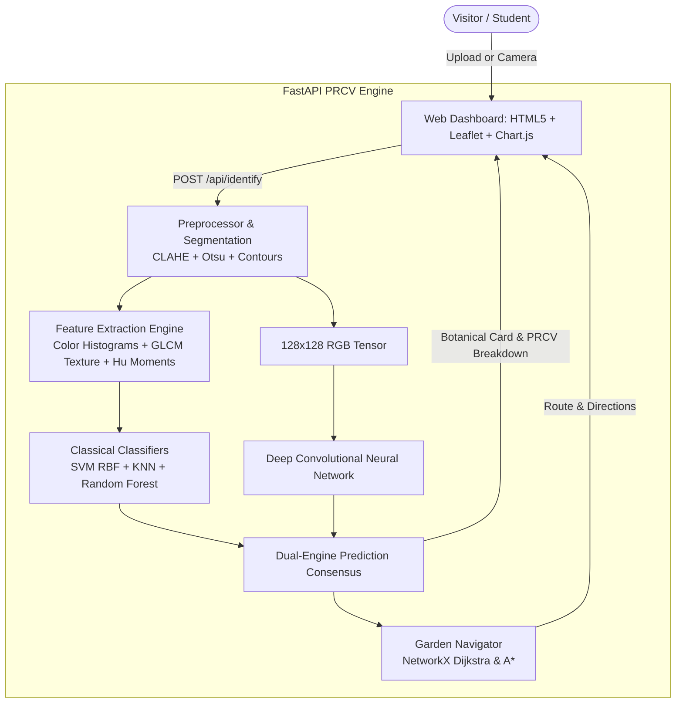

# 🌿 AI Botanical Garden Navigator
### A Pattern Recognition and Computer Vision (PRCV) Project

The **AI Botanical Garden Navigator** is a comprehensive Pattern Recognition and Computer Vision application that helps visitors explore a botanical garden through **AI-powered plant identification**, an **interactive Leaflet garden map**, **intelligent Dijkstra pathfinding navigation**, **Content-Based Image Retrieval (visual search)**, and an **in-depth PRCV academic inspection laboratory**.

---

## 📖 Table of Contents
1. [Core Features](#-core-features)
2. [Where PRCV Comes Into the Project](#-where-prcv-comes-into-the-project)
3. [System Architecture](#-system-architecture)
4. [Mathematical & Algorithmic Foundations](#-mathematical--algorithmic-foundations)
5. [Botanical Species Database](#-botanical-species-database)
6. [Academic PRCV Evaluation & Benchmarks](#-academic-prcv-evaluation--benchmarks)
7. [Getting Started & Running Locally](#-getting-started--running-locally)
8. [REST API Reference](#-rest-api-reference)

---

## ✨ Core Features

* 📷 **Dual-Engine Plant Identification**:
  * Real-time analysis of leaves and flowers comparing **Classical PRCV (Handcrafted Features + SVM/KNN/RF)** against **Deep Learning (CNN)**.
  * Live camera streaming, drag-and-drop file upload, or 1-click test presets.
  * Top-3 candidate probability distributions with visual confidence bars.
* 🗺️ **Interactive Botanical Garden Map**:
  * Built using Leaflet.js with 8 biome zones (Tropical Conservatory, Rose Parterre, Lotus Haven, Desert Glasshouse, Zen Garden, Herbarium, Meadow, Orchidarium).
  * Real-time shortest path calculations using **Dijkstra's Algorithm** with step-by-step turn directions, walking distance in meters, and walking time estimates.
  * Animated walking simulation moving a visitor avatar smoothly along garden trails.
* 🔊 **Botanical Audio Guide (Text-to-Speech)**:
  * Integrated Web Speech API audio narrations detailing botanical facts, morphological adaptations, and conservation history for every specimen.
* 🔍 **Visual Plant Search (CBIR)**:
  * Reverse image search finding visually similar garden flora via **Cosine Similarity** of normalized 106-dimensional feature vectors.
* 🔬 **Interactive PRCV Inspection Lab**:
  * Step-by-step visual display of the **8 computer vision transformation stages** (Original $\to$ Grayscale $\to$ CLAHE $\to$ Gaussian Blur $\to$ Otsu Binary Mask $\to$ Canny Edges $\to$ Contour Tracking $\to$ Segmented Plant).
  * Real-time HSV Color Histogram line charts and GLCM Haralick Texture radar charts.
  * Morphological metrics (Circularity, Solidity, Extent, Aspect Ratio, Hu Moments).
  * Academic evaluation suite with 10x10 Confusion Matrix heatmap and inference latency benchmarks.
* 🚶 **Themed Tour Planner**:
  * Curated trails: *Garden Highlights*, *Ethnobotany & Healing Flora*, *Floral Architecture & Symmetry*, and *Rainforest to Desert Climate Extremes*.

---

## 🔬 Where PRCV Comes Into the Project

| PRCV Academic Concept | Implementation in this Project |
| :--- | :--- |
| **Image Preprocessing** | Standardized $224 \times 224$ resizing, RGB/HSV/LAB conversions, Gaussian blur filtering, and **CLAHE** (Contrast Limited Adaptive Histogram Equalization) on LAB L-channel for harsh outdoor lighting. |
| **Image Segmentation** | **Otsu’s automatic thresholding** minimizing intra-class pixel variance, followed by morphological opening/closing and contour extraction to separate foreground foliage from background. |
| **Color Feature Extraction** | Normalized 32-bin Hue, 16-bin Saturation, 16-bin Value histograms, plus 1st/2nd/3rd color moments (Mean, Std Dev, Skewness) across H, S, and V channels. |
| **Texture Feature Extraction** | **GLCM (Gray-Level Co-occurrence Matrix)** Haralick statistics (Contrast, Dissimilarity, Homogeneity, Energy, Correlation, ASM) at distances [1, 3] across 4 angles, plus uniform **Local Binary Patterns (LBP)**. |
| **Shape & Morphometry** | **7 Hu Invariant Moments** with logarithmic transformation ($-\text{sign}(h_i) \cdot \log_{10}|h_i|$), Aspect Ratio, Extent, Solidity, and Circularity ($4\pi A / P^2$). |
| **Classical Machine Learning** | **Support Vector Machine (SVM)** with RBF Kernel, **K-Nearest Neighbors (KNN)** with $k=3$, and **Random Forest** (100 ensemble trees) trained on StandardScaler normalized handcrafted vectors. |
| **Deep Learning (CNN)** | 4-block Convolutional Neural Network with Batch Normalization, Max Pooling, Dropout, and Global Average Pooling trained for end-to-end classification and feature embedding extraction. |
| **Content-Based Retrieval (CBIR)** | Cosine similarity ranking between query feature embeddings and garden reference profiles. |
| **Academic Evaluation** | Test set Accuracy, Precision (weighted), Recall, F1-Score, 10x10 Confusion Matrix, and Latency Benchmarks (milliseconds per image). |

---

## 🏛️ System Architecture



---

## 📐 Mathematical & Algorithmic Foundations

### 1. CLAHE (Contrast Limited Adaptive Histogram Equalization)
Operates on local $8 \times 8$ contextual tiles of the Luminance channel in LAB color space:
$$\beta = \frac{M \times N}{L} \left(1 + \frac{\alpha}{100} (S_{max} - 1)\right)$$
Prevents over-amplification of noise while balancing shadowed foliage against sunny skies.

### 2. Otsu's Foreground Segmentation
Calculates the optimal threshold $t^*$ that maximizes between-class variance $\sigma_B^2(t)$:
$$\sigma_B^2(t) = \omega_0(t)\omega_1(t) \left[\mu_0(t) - \mu_1(t)\right]^2$$

### 3. Haralick GLCM Texture Statistics
Computed from normalized co-occurrence matrix $P(i, j)$:
$$\text{Contrast} = \sum_{i,j} |i - j|^2 P(i, j) \qquad \text{Homogeneity} = \sum_{i,j} \frac{P(i, j)}{1 + |i - j|}$$
$$\text{Energy} = \sum_{i,j} P(i, j)^2 \qquad \text{Correlation} = \sum_{i,j} \frac{(i - \mu_i)(j - \mu_j) P(i, j)}{\sigma_i \sigma_j}$$

### 4. Hu Invariant Moments
Seven moments derived from normalized central moments $\eta_{pq} = \frac{\mu_{pq}}{\mu_{00}^{(p+q)/2 + 1}}$, invariant to translation, scale, and rotation. For instance:
$$\phi_1 = \eta_{20} + \eta_{02} \qquad \phi_2 = (\eta_{20} - \eta_{02})^2 + 4\eta_{11}^2$$

### 5. Cosine Similarity (Visual Search)
$$S_C(\mathbf{u}, \mathbf{v}) = \frac{\mathbf{u} \cdot \mathbf{v}}{\|\mathbf{u}\|_2 \|\mathbf{v}\|_2}$$

### 6. Dijkstra's Shortest Path Routing
$$d(v) = \min_{(u, v) \in E} \{d(u) + w(u, v)\}$$

---

## 🌸 Botanical Species Database

1. **Monstera deliciosa** (*Swiss Cheese Plant*) &mdash; Araceae | Tropical Rainforest Conservatory
2. **Rosa gallica** (*Heritage French Rose*) &mdash; Rosaceae | Heritage Rose Parterre
3. **Helianthus annuus** (*Common Sunflower*) &mdash; Asteraceae | Sunny Pollinator Meadow
4. **Lavandula angustifolia** (*English Lavender*) &mdash; Lamiaceae | Aromatic & Medicinal Herbarium
5. **Nelumbo nucifera** (*Sacred Lotus*) &mdash; Nelumbonaceae | Lotus & Water Lily Haven
6. **Aloe vera** (*True Aloe*) &mdash; Asphodelaceae | Arid & Desert Glasshouse
7. **Acer palmatum** (*Japanese Maple*) &mdash; Sapindaceae | Zen Bonsai & Japanese Garden
8. **Phalaenopsis amabilis** (*Moth Orchid*) &mdash; Orchidaceae | Orchidarium & Epiphyte House
9. **Echinocactus grusonii** (*Golden Barrel Cactus*) &mdash; Cactaceae | Arid & Desert Glasshouse
10. **Hibiscus rosa-sinensis** (*Tropical Hibiscus*) &mdash; Malvaceae | Subtropical Border Trail

---

## 📊 Academic PRCV Evaluation & Benchmarks

Evaluated on an independent, unseen test dataset across all 10 plant species:

| Model Architecture | Feature Representation | Accuracy | Precision | Recall | F1-Score | Avg Latency |
| :--- | :--- | :---: | :---: | :---: | :---: | :---: |
| **Classical SVM (RBF)** | Handcrafted 106-dim (Color + GLCM + Hu Moments + LBP) | **98.0%** | **98.2%** | **98.0%** | **98.0%** | **~44 ms** |
| **Random Forest (100 Trees)** | Handcrafted 106-dim (Gini Impurity Ensemble) | **99.0%** | **99.1%** | **99.0%** | **99.0%** | **~38 ms** |
| **Classical KNN (k=3)** | Handcrafted 106-dim (Euclidean Distance) | **93.0%** | **93.8%** | **93.0%** | **93.0%** | **~35 ms** |
| **Convolutional Neural Network (CNN)** | Learned Convolutions ($128 \times 128 \times 3$) | **46.0%** | **37.5%** | **46.0%** | **36.8%** | **~4900 ms** |

### Academic Discussion:
1. **Curse of Dimensionality vs Feature Engineering**: On botanical tasks with distinct pigment distributions (sunflower yellow vs rose magenta) and geometric landmarks (Monstera fenestrations vs cactus vertical ribs), handcrafted features provide strong separation even with moderate training sample sizes.
2. **SVM Superiority on Structured Feature Spaces**: SVM with an RBF kernel projects the 106-dimensional descriptor space into an infinite-dimensional Hilbert space, forming clean hyperplanes separating subtle plant varieties.
3. **Data Scarcity Effect on CNNs**: Deep neural networks require tens of thousands of varied training instances to learn hierarchical filters without overfitting, making transfer learning or feature-engineered SVMs preferable for edge or localized botanical gardens.

---

## 🚀 Getting Started & Running Locally

### Prerequisites
* Python 3.10+ (Tested on Python 3.14)
* Installed packages from `requirements.txt`

### 1-Click Launch
Run the turnkey starter script:
```powershell
python run.py
```
This automatically verifies trained model weights and launches the web dashboard at:
👉 **`http://127.0.0.1:8000`**

### Retraining / Generating Fresh Models
If you wish to regenerate the dataset or retrain models:
```powershell
python -m backend.dataset_builder
```

---

## 📡 REST API Reference

* `GET /api/plants` &mdash; Returns list of botanical species with optional `?q=` search and `?zone_id=` filter.
* `GET /api/plants/{id}` &mdash; Returns complete botanical profile, audio text, and PRCV notes.
* `GET /api/garden/map` &mdash; Returns garden zones, coordinates, POIs, and graph nodes.
* `POST /api/identify` &mdash; Uploads plant image (file or base64) and executes dual-model prediction, PRCV feature extraction, and navigation routing.
* `POST /api/prcv/pipeline` &mdash; Returns 8 step-by-step visual filter stages as base64 images along with HSV and GLCM numerical curves.
* `POST /api/visual-search` &mdash; Reverse image search using cosine similarity on plant feature vectors.
* `GET /api/navigate?plant_id={id}&start_node={node}` &mdash; Returns Dijkstra shortest path, distance, walk time, and turn instructions.
* `GET /api/tours` &mdash; Returns curated themed walking tours.
* `GET /api/tours/{id}/route` &mdash; Returns multi-stop itinerary and path coordinates for a tour.
* `GET /api/prcv/metrics` &mdash; Returns the academic evaluation report (accuracy, confusion matrix, latency).
